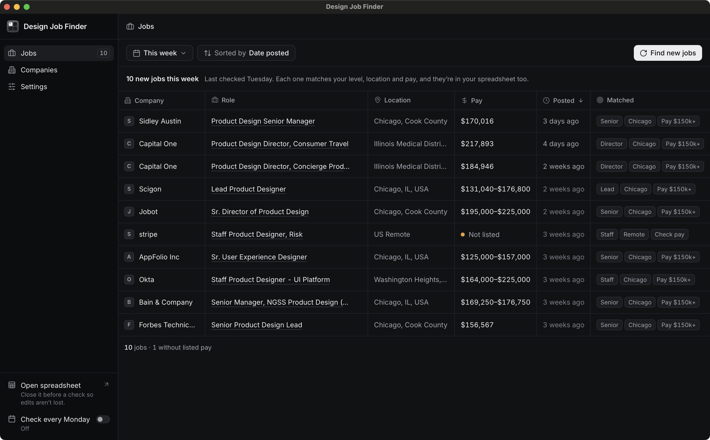

# Design Job Finder

For product, UX, UI and brand designers who are tired of checking job sites. Once a week it finds design jobs that match your level, location and pay, and adds them to a spreadsheet or Notion. You don't need to know how to code.



```
Status            Company   Title                            Location     Salary              Link
Ready for Review  Acme      Senior Product Designer, Growth  Remote - US  $185,000–$230,000   https://…
New               Globex    Staff Product Designer           Chicago, IL  unlisted (check …)  https://…
Applied           Initech   Design Manager, Platform         Remote - US  $200,000–$250,000   https://…
```
<sub>Each row also says why the job matched. If you turn on drafts, it holds tailored resume bullets and a cover letter opening too.</sub>

## Install

You need a Mac. (On Windows or Linux, see [For developers](#for-developers).)

1. Open **Terminal**: press **⌘ Command + Space**, type `Terminal`, press **Return**.
2. Paste this line and press **Return**:

   ```
   curl -fsSL https://raw.githubusercontent.com/eriklevitch/design-job-finder/main/install.sh | bash
   ```

3. Design Job Finder opens and asks four short questions: the **type of design** and **level** you're after, your **locations**, your **minimum pay**, and any **companies** you'd like to work at.
4. Click **Find my first jobs**. New jobs go to a spreadsheet; you can switch to Notion in Settings.

That's the last time you need Terminal. Design Job Finder is now in your Dock.

## How it works

It searches Indeed and the careers pages of the companies you pick (any company on Greenhouse, Lever or Ashby, which covers most tech companies). It keeps jobs whose title, level, location, pay and posting date match, skips ones already in your tracker, and adds the rest.

It won't apply for you or contact anyone. It doesn't collect data: your settings, notes and tracker stay on your Mac. It doesn't search LinkedIn, which blocks automated searches, and for now it only finds jobs in the US.

## Each week

Open **Design Job Finder** from your Dock. It shows this week's new jobs, how old each posting is, and why it matched. Click **Find new jobs** to check again (1–3 minutes), or turn on **Check every Monday** and your Mac will check at 9am and send you a notification.

As you go through jobs, update **Status** in your tracker:

| Status | Meaning |
|---|---|
| **New** | Just found. |
| **Ready for Review** | Just found, and a draft is ready (if you turned drafts on). |
| **Applied** | You applied. Add the date in **Date applied**. |
| **Interview** / **Offer** / **Rejected** | How it's going. |
| **Not interested** | Hides it. Use this instead of deleting the row, so the job doesn't come back next week. |

<details>
<summary><b>Tips for the spreadsheet</b></summary>

- **Excel, Google Sheets and LibreOffice** edit `applications.csv` directly. Change Status, Date applied and Notes, then save.
- **Numbers** saves your edits as a separate `.numbers` file, and new jobs keep going to `applications.csv`. To keep everything in one place, use Excel or Google Sheets, or switch to Notion (Design Job Finder → **Settings**).
- **Close the spreadsheet before you click Find new jobs.** Otherwise your next save erases the new rows.
- Don't edit the **ID** column (the last one). It's how the tool recognizes jobs it has already added.
- Drafts are also saved as text files in the `drafts` folder, which makes them easier to copy.
</details>

## Change your search

Open **Settings** in Design Job Finder, change what you like, and click **Save**. Add or remove companies on the **Companies** page.

<details>
<summary><b>Editing settings by hand</b></summary>

For finer changes, right-click `config.yaml` in your job-search folder, choose **Open With → TextEdit**, and edit the **YOUR SEARCH** section at the top. Saving in Settings or Companies rewrites the type of design, level, location, pay and company lines, so make hand edits to those after you've used the app.

| Setting | What it means |
|---|---|
| `title_keywords` | A job title has to include one of these, e.g. `"product design"`, `"ux"`. Settings → Type of design fills this in. |
| `search_terms` | What to search for on Indeed (and Adzuna), e.g. `"brand designer"`. Each one is a separate search. |
| `seniority_keywords` | A title also has to include one of these level words, e.g. `"senior"`, `"staff"`. `[]` means any level. |
| `locations` | Places that count. Add `"remote"` to include US-remote jobs. `[]` means anywhere. |
| `search_location` | The city (or "United States") used when searching Indeed. |
| `min_salary` | Jobs whose posted pay tops out below this are skipped. Jobs that don't list pay are always kept. |
| `max_posting_age_days` | How recent a posting must be. |
| `greenhouse_companies`, `lever_companies`, `ashby_companies` | Companies checked directly. The **Companies** page fills these in for you. |
| `tracker` | `"spreadsheet"` or `"notion"`. |

Keep the format exactly as you see it: words in `"quotes"`, lists in `[square brackets]`, separated by commas. Then click **Find new jobs** to check the results.
</details>

<details>
<summary><b>Adding a company Design Job Finder couldn't find</b></summary>

Open the company's careers page and click any job. Look at the web address:

- `job-boards.greenhouse.io/acme/...` → add `"acme"` to `greenhouse_companies`
- `jobs.lever.co/acme/...` → add `"acme"` to `lever_companies`
- `jobs.ashbyhq.com/acme/...` → add `"acme"` to `ashby_companies`

If the address is anything else (for example, Workday or the company's own site), it can't be checked directly. Indeed will often still list their jobs.
</details>

### Extras

Turn these on in **Settings → Extras**, then click **Save**.

<details>
<summary><b>Tailored drafts (about 1–2 cents per job)</b></summary>

For every new job, it writes three resume bullets and a cover letter opening. It uses only what you've written in `portfolio_notes.md`, so it won't invent experience you don't have.

1. Create an account at [console.anthropic.com](https://console.anthropic.com), add a few dollars of credit, then go to **API Keys → Create Key**.
2. In **Settings → Extras**, paste the key in **Anthropic API key**.
3. Under **Your experience**, replace the examples with your real experience: companies, what you led, and results with numbers. Drafts can only be as specific as these notes.
4. Click **Save**. The key then shows **Connected**.

You can also change the drafts' writing rules under `writing_style` in `config.yaml`.
</details>

<details>
<summary><b>More listings from Adzuna (free)</b></summary>

Adzuna adds listings from many other job sites. Sign up at [developer.adzuna.com](https://developer.adzuna.com), copy your **App ID** and **App Key**, paste them in **Settings → Extras → More listings from Adzuna**, and click **Save**.
</details>

<details>
<summary><b>Notion instead of a spreadsheet (free)</b></summary>

Design Job Finder builds the database for you, with all the columns. In **Settings → Where new jobs go**, choose **Notion**. It asks you to:

1. Go to [notion.so/profile/integrations](https://www.notion.so/profile/integrations), click **New integration**, name it "Design Job Finder", save, and copy the **Internal Integration Secret**.
2. Open (or create) the Notion page the tracker should live in. Click **•••** (top right) → **Connections** and add "Design Job Finder".
3. On that page, click **Share → Copy link**.

Paste the secret and the link, then click **Connect Notion**. Drafts appear inside each job's page.
</details>

## Need help?

<details>
<summary><b>It found 0 matches</b></summary>

Your settings may be too narrow. When most jobs were skipped because of location, level or pay, Design Job Finder says so and has a button that takes you to that setting. Otherwise, try "Any level", more cities, remote included, a lower minimum pay, or more companies.
</details>

<details>
<summary><b>A job showed up that clearly isn't a fit</b></summary>

The **Why it matched** column shows which settings it matched. To block a word in titles, add it to `title_excludes` in `config.yaml` (in the advanced section).
</details>

<details>
<summary><b>A search found far fewer jobs than usual</b></summary>

One of the job sources may have failed. Open the `logs` folder in your job-search folder and open `app_run.log` (or `scheduled.log` for the Monday check) in TextEdit.

- **`[jobspy] error`** means the Indeed search failed. This happens when Indeed changes its site or limits how often it can be searched. The other sources still run. To fix it, update by pasting the install line into Terminal again. Your settings, notes and tracker are kept.
- **`404 Not Found` next to a company** means that company's name is wrong or it moved to a different careers system. Remove it on the **Companies** page and add it again, or see "Adding a company Design Job Finder couldn't find" above.
</details>

<details>
<summary><b>A company shows "Not found"</b></summary>

Design Job Finder can't read that company's careers page. It may use a system Design Job Finder can't check (like Workday, or the company's own site), or its page may use a different name. On the **Companies** page, try the spelling from their careers page address, or see "Adding a company Design Job Finder couldn't find" above. Indeed often lists their jobs anyway.
</details>

<details>
<summary><b>How do I update to the newest version?</b></summary>

Paste the install line into Terminal again. Your settings, notes, keys and tracker are kept.

If Design Job Finder still opens in your browser after updating, quit it (⌘ Q, or close the browser tab) and click it in your Dock again.
</details>

<details>
<summary><b>How do I uninstall?</b></summary>

If **Check every Monday** is on, turn it off first. Then drag the job-search folder and **Design Job Finder** (in the Applications folder in your home folder) to the Trash, and remove Design Job Finder from your Dock. Nothing else was installed.
</details>

## For developers

<details>
<summary><b>Manual install (Mac, Linux, Windows)</b></summary>

Needs Python 3.10+.

```
git clone https://github.com/eriklevitch/design-job-finder.git job-search
cd job-search
python3 -m venv venv
venv/bin/pip install -r requirements.txt        # Windows: venv\Scripts\pip install -r requirements.txt
venv/bin/python engine/setup_wizard.py           # Windows: venv\Scripts\python engine\setup_wizard.py
```

Then run `venv/bin/python engine/main.py` each week (`--dry-run` to preview), and `engine/open_tracker.py` to open the tracker. You can also use Design Job Finder without the Dock app: `venv/bin/python engine/app_server.py` starts it in its own window (add `--browser` to use your browser instead; on Windows and Linux it opens in your browser). Monday checks and the Dock app only work on a Mac.
</details>

<details>
<summary><b>What's in the folder</b></summary>

| File | What it is |
|---|---|
| `config.yaml` | Your settings (made by Design Job Finder from `config.example.yaml`). |
| `portfolio_notes.md` | Your experience, used for drafts. |
| `.env` | Your keys (hidden file). |
| `applications.csv`, `drafts/` | Your tracker and drafts. |
| `logs/`, `history.json` | What the latest searches did, and the jobs they found (about 8 weeks). |
| `engine/` | The code. `app_server.py` and `app/` are the Design Job Finder app (a page shown in its own window), `mac_app.py` makes the Dock app, `schedule.py` and `scheduled_run.py` run the Monday search, `config_store.py` saves settings, `main.py` runs the search, `sources.py` fetches and filters jobs, `draft.py` writes drafts, `tracker_csv.py` and `notion_client.py` save jobs, `check_boards.py` checks company names. |
| `tests/` | Automated checks for the filtering rules and the app. |

Everything in the first five rows is personal and is never uploaded (see `.gitignore`).
</details>

<details>
<summary><b>Checking that the filtering is right</b></summary>

1. **Run the tests:** `venv/bin/pip install pytest` once, then `venv/bin/python -m pytest -q`. They check the title, level, location, date and pay rules against known examples. If you change a rule, add a test in `tests/test_sources.py`.
2. **Preview against real jobs:** run `venv/bin/python engine/main.py --dry-run` (it saves nothing), open 3–5 of the links and confirm the title, location, pay and date really match.
3. **Check the skip counts.** If one reason looks too high, open a few raw postings. A common cause is a location written differently than you expected, such as "NYC" instead of "New York". Add the other spelling to `locations`.
4. **Check company names:** `venv/bin/python engine/check_boards.py` checks every company in your settings and says which ones are on the wrong list or misspelled.
</details>

<details>
<summary><b>Using an AI coding assistant</b></summary>

If you use Claude Code or a similar tool, open this folder in it and ask: "Set this up for me" or "Add these companies to my search". `CLAUDE.md` tells the assistant how the project works.
</details>

---

Indeed search uses [JobSpy](https://github.com/speedyapply/JobSpy). The app uses the [Inter](https://rsms.me/inter/) and [JetBrains Mono](https://www.jetbrains.com/lp/mono/) fonts (SIL Open Font License). Company job lists come from the public Greenhouse, Lever and Ashby job-board APIs. MIT license.
